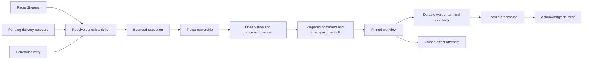

# Delivery recovery and ownership

Forge separates observation acceptance from workflow execution. Acceptance means
that provider evidence passed reconciliation; it does not establish that a
command ran. Each newly accepted observation has a durable processing record,
created in the same transaction as acceptance. Redelivery consults that record
and resumes unfinished work using its original command evidence.

## Ticket writes

Ticket identity is resolved before taking the execution lock. Events correlated
through a pull-request index therefore contend on the same key as Jira events
for that ticket. Missing correlation is retried rather than running under an
empty ticket lock.

Lease loss cancels local execution. Cancellation alone is insufficient: a paused
process can wake after another worker has acquired the ticket. The checkpoint
Redis client also checks ownership inside a `WATCH`/`MULTI` transaction for each
write or library-created pipeline. Redis key expiry or a replacement owner
invalidates the transaction. This protects checkpoint JSON, pending writes,
indexes, and latest-checkpoint pointers. A successful lock renewal may require
retrying the transaction, but does not invalidate the owner's token.

Ownership travels through asynchronous task context. An operation without ticket
context, such as an operator maintenance command, must follow its own exclusion
protocol. Stop workers before maintenance that rewrites checkpoints. The guarded
checkpoint client supports Forge's single Redis deployment; it does not add
Redis Cluster support.

## Recovery boundaries

A command's prepared decision and checkpoint handoff distinguish work that has
not started from a transition already applied to the workflow. Recovery must not
reinterpret an old approval against the workflow's newer position. Legitimate
waits, explicit ignores, and terminal results are durable boundaries; receiving
an observation or finding any checkpoint for a ticket is not sufficient evidence
of completion.

Pending stream recovery and scheduled retries use the same bounded dispatch and
execution protocol as new messages. Retry schedules and ownership remain
transport state, separate from command application. A backlog remains in Redis
when dispatch capacity is exhausted.

Effects have independent, renewable claim tokens. Completing or rescheduling an
effect requires its current token, so an expired executor cannot overwrite its
replacement's result. The recovery service claims work immediately before
execution rather than leasing a batch that will wait locally.

## Limits

These mechanisms depend on Redis retaining its durable records. Configure and
test persistence, backups, and restoration for the required recovery objective;
a persistent volume alone does not define the acknowledgement durability policy.

A provider request already in flight cannot be revoked by losing a local lease.
Provider idempotency or evidence-based reconciliation is still required. An
ambiguous operation that cannot be safely reconciled needs operator attention.
Uncheckpointed model work can repeat after a crash; the protocol does not promise
exactly-once model execution.

Legacy accepted observations have no reliable command-application marker. Treat
missing processing records as ambiguous historical state, not automatic approval
to replay them. Preserve the old observation and compare command, checkpoint,
effect, and provider evidence before recovering an individual ticket.
